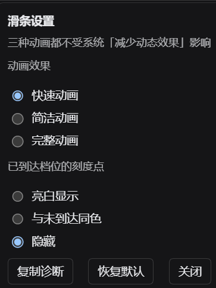
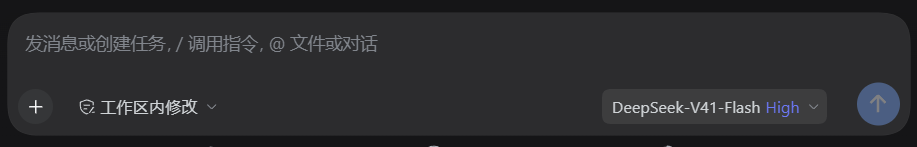
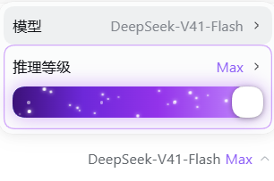
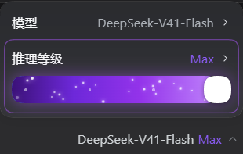
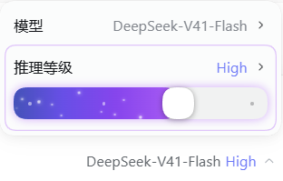
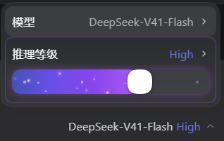
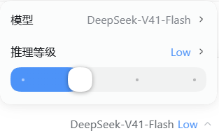
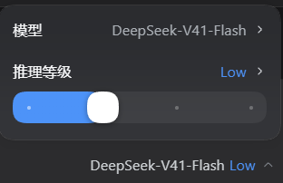
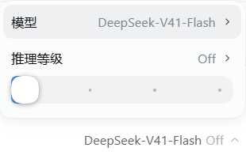
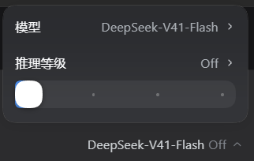

# dsh-codex-effort-slider-ultra

[](https://github.com/wgica/dsh-codex-effort-slider-ultra/blob/main/LICENSE) [](https://github.com/wgica/dsh-codex-effort-slider-ultra/blob/main/CHANGELOG.md) [](https://github.com/wgica/dsh-codex-effort-slider-ultra/stargazers)

> **本仓库是 [dsh-codex-effort-slider](https://github.com/Microqian2th/dsh-codex-effort-slider)（上游出处，MIT）的 Ultra 分支，版本 `v1.5.6`。**
> 与上游 1.1.4 相比多三件事：滑条最右端多一个 **Ultra** 档 —— 它映射到该模型**真实的最高**
> `reasoning_effort`，并把一段指令折进系统提示词（宿主半边 `lib/index.js`）；这句指令
> **可以在 DSH 官方「插件」页里直接改**，改完下一轮对话就生效，不需要重装或重启；
> v1.4.0 起**滑向 Ultra 时会播一段过渡文字**（Ultra 紫 + 少量偏紫白点缀、从右往左扫，垂直居中在
> 「推理等级」那一行），开关与文案都在设置面板的「Ultra 过渡动画」里；
> v1.4.1 修了扫光方向（之前反了）和垂直位置（之前偏下、贴着滑条）。
> v1.4.2–v1.4.4 把渐变从偏蓝调成 Ultra 紫、移除会带坏裁剪的 `filter`、收窄并按你的要求调了偏白段。
> **v1.5.0**：偏白段再收到约 1.6%，发光改用 `text-shadow` 加回来；字号 13→14px、字重 600→500；
> 官方「插件」页那一行现在也能开关过渡动画、直接改过渡文案（不必再进滑条设置面板）。
> **v1.5.1**：扫光改成**只跑一遍**（之前 `infinite` 一圈结束后亮带会从右侧重新冲进来，看着像循环）；
> 字号再大一档到 15px。
> **v1.5.2**：深紫起手定在 `#6d28d9`（更深的尝试观感偏糊），并**把发光从 `text-shadow` 挪到独立的 `.ces-flash__glow`（blur 兄弟节点）**——Chromium 在带 `text-shadow` 的元素上会放弃 `background-clip:text` 裁剪，
> 把渐变画成一块矩形底色，也就是那个「遮罩」；正文 span 现在保证零 paint effect。
> **v1.5.3**：入场位移（`translateX(42%)` + 淡入）整体挪到新的 `.ces-flash__stack` 上，发光层与正文都是它的子节点 ⇒ 从右边滑进来时两层严格一起动（此前发光层留在中间、和文字错位）；发光层改为在 stack 左上角定位（`left:0;top:0`，不再 `translate(-50%,-50%)`）逐字对齐；字号 15px → 14px。
> **v1.5.4**：字体定为 `'Microsoft YaHei','DengXian','PingFang SC','Hiragino Sans GB','Heiti SC','SimHei',sans-serif`（14px / 400、`letter-spacing:normal`、`font-synthesis:none`，不让浏览器给中文合成假粗体）；发光层与正文同一套字体。
> **v1.5.5**：过渡文字整体上抬 `FLASH_LIFT_PX`（当前 **2px**；3px 时观感「太靠上」，中文视觉重心比行框中心低，抬一点后与「推理等级」那一行观感对齐，可调 2–5px）。
> 其余档位、配色、动画与上游完全一致。

给 [DeepSeek Harness](https://github.com/deepseek-ai/deepseek-harness)（DSH）用的 **Codex 风格推理等级滑条**。

**一档一色、越往右越"通电"**：填充从蓝渐变到紫罗兰，高档位亮起紫色星云与星尘粒子，
连官方那一行的数值文字也跟着变色（`Off` 档保持官方灰）。

## 怎么用

1. **拖**：在模型菜单里那条滑条上按住拖动 —— 跟手连续运动，**拖到哪一档就即时变成哪一档**
   （滑过档位边界就把官方档位切过去，不用等松手）。
2. **右键**：在**滑条上点右键**打开设置面板 👇
3. 设置**即时生效并记住**；出问题时点一下「复制诊断」把逐帧记录导出。



| 设置项 | 可选 | 说明 |
|---|---|---|
| **动画效果** | **快速动画** / 简洁动画 / 完整动画 | 三种**都不受系统「减少动态效果」影响**（否则系统一开就退化成"瞬跳"）。**快速**复刻 Codex 桌面版手感 —— 旋钮**不跟手**、停在档位格上，指针越过 1/3 档距才切下一格（后退要退回 2/3，带滞回），**约 70~85ms 吸附到位且无回弹**；**简洁**更干脆；**完整**最跟手、惯性更长 |
| **已到达档位的刻度点** | 亮白显示 / 与未到达同色 / 隐藏 | 控制轨道上那些定位小点的可见性 |
| **Ultra 过渡动画** | 开 / 关（默认开） | 从更低档滑到 Ultra 的**那一瞬间**，官方那一行 `推理等级 Ultra` 先被临时顶掉，换成居中的过渡文字（Ultra 紫渐变 + 偏紫白扫光点缀、从右往左扫），停留约 1.4s 后淡出、原文字自动还原；播放中若又滑离 Ultra 会立刻收掉。只在"往上滑进 Ultra"时播，恢复 Ultra 状态/心跳重试不会重播。**滑条设置面板与官方「插件」页那一行都能改** |
| **过渡文字** | 任意文本（默认「更快消耗使用额度」，上限 40 字） | 过渡动画显示的那几个字；留空则落回默认文案。**滑条设置面板与官方「插件」页那一行都能改** |
| | | **复制诊断**（逐帧记录，反馈问题时用）/ **恢复默认** / **关闭** |

## Ultra 档（本分支新增）

滑条最右端多一个 **Ultra** 停靠点（虚拟第 N+1 档）：

- **档位语义**：仍然写回该模型**真实的最高档** `reasoning_effort` —— 不伪造宿主不认识的等级，
  所以官方一整套校验、状态回报、回滚逻辑照旧生效。
- **固定指令**：滑条停在 Ultra 时，客户端 `POST /dsh-codex-effort-slider-ultra/ultra`
  （只接受 loopback 同源请求）告知宿主；宿主用 `systemPrompt.section({ name: "codex-effort-slider:ultra" })`
  把一段固定指令折进系统提示词 ——「**不要吝惜 Token，把预算用满；必要时开启智能体团队**」（大意；
  **逐字原文**见 `lib/index.js` 的 `ULTRA_PROMPT`，加载时可用 `config.prompt` 覆盖）。
- **指令文案可改（v1.3.0 起；v1.3.2 修了深色模式对比度）**：默认文案是那句「无限 token」提示词。要改它，去
  **设置 → 插件 → 本插件那一行 → 配置**（官方插件页的 `plugins.row.config` 插槽），
  或右键滑条 → 设置面板里的「Ultra 指令」框；两处读写的是**同一份**插件配置。
  保存后由 Loader 原地更新 volatile 字段，**下一轮对话就生效**，不重装、不重启。
  文本框留空 = Ultra 只抬 effort、不注入任何指令；「恢复默认」删掉用户层覆盖。
  v1.3.1 起这一行**不会出现"没有配置表单"的死路**：官方 `form` 没下发时（宿主没把
  `Config` 认成配置命名空间等），同一个位置会换成插件自带的编辑器，走同一条同源桥、
  同一份配置，功能完全一致。
- **开关真值**：客户端按 `session + model` 记在 `localStorage`，并每 30s 心跳重报一次；
  宿主重启后客户端会自动重新 POST 恢复。
- **过渡动画（v1.4.0 起）**：从更低档滑到 Ultra 的那一刻，`activateUltra()` 播一次过渡文字
  —— 把官方那一行（`推理等级` 标签、数值文字、箭头）临时设为 `visibility:hidden`，
  在同一个 `<div>` 里叠一层 `div.ces-flash`，里面是 `.ces-flash__text`（文字走
  `background-clip:text` 的 Ultra 紫渐变 + 白色点亮 + `ces-flash-in` 入场 + `ces-flash-sweep` 单次右→左扫）。
  调色板取 Ultra 能量层同一族紫（从 `#6d28d9` 起手，经 `#8b5cf6`→`#9333ea`→`#a855f7`→`#c084fc` 到偏紫白，和滑条能量层同源），中间插一段
  `#e9d5ff`/`#f2e6fe`/`#eaddfe` 的偏紫白扫光（v1.4.2 起不再掺滑条起点的蓝 `#4d93f8`；
  v1.4.3 把白色段从 17% 收到约 5%，浅紫/深紫的色标位置不变；v1.4.4 把最亮处往紫偏约 20%，
  不再是纯白；**v1.5.0 再收到约 1.6%**，只留一道窄亮带）；220% 背景宽让亮带
  随扫动画穿过文字。字体：`'Microsoft YaHei','DengXian','PingFang SC','Hiragino Sans GB','Heiti SC','SimHei',sans-serif`，14px / 400、`letter-spacing:normal`、`font-synthesis:none`（不让浏览器给中文合成假粗体）。深紫色标仍是 `#6d28d9` 起手。发光由**独立的 `.ces-flash__glow`** 承担（同文字、`color:rgba(168,85,247,.55)` + `filter:blur(6px)`，绝对定位在 `.ces-flash__stack` 左上角、`aria-hidden`，与正文同一个入场位移）；正文 span 只用
  纯渐变（零 `text-shadow`/`filter`）。
  **不要给这个 span 加 `filter`/`drop-shadow`**：Chromium 会把
  `background-clip:text` 的裁剪带坏，文字周围出现一块异色底（v1.4.3 移除的就是它，
  v1.5.0 的发光故意改用 `text-shadow` 就为绕开这个坑）。
  过渡层的位置取**第一行文字自身的实测框**（`current.lineTop` / `current.lineHeight`，来自
  `value.getBoundingClientRect()` 相对 `row.getBoundingClientRect()` 的偏移），所以文案是
  居中盖在「推理等级 Ultra」那一行上，而不是贴在滑条上方；
  `background-position` 从 `0% → 108%` 让渐变图案向左滑到底，与滑条自身的扫光同向（v1.4.1 修正方向，
  v1.5.1 改成 `1` 次 + `both`：亮的白带从右边进来、从左边出去就停住，不再循环回右侧）。
  停留 `FLASH_HOLD_MS`(1400ms) 后打 `data-out="1"` 淡出，再 `FLASH_OUT_MS`(300ms) 移除并
  逐个子节点还原 `visibility`。开关/文案两处都能改：长按滑条 → 设置面板「Ultra 过渡动画」组，
  或 设置 → 插件 → 本插件那一行 → 配置（v1.5.0 起官方页里也渲染了开关和文案输入框，
  和滑条面板共用同一份 `localStorage` 设置）；系统开了
  `prefers-reduced-motion` 时只保留淡入。纯视觉：任何异常都被 try/catch 吞掉，不影响切档。
- **fail-open**：宿主缺 `systemPrompt` / `webServer` 服务、或会话不存在时桥返回 `ok:false`，
  客户端只是**不注入指令**，滑条与档位照常工作。schemastery 拿不到时 `Config` 退化为
  `undefined`（官方页面不出现官方表单，但**兜底编辑器照常可用**），注入逻辑仍读
  `config.prompt` / 默认文案。
- **自检**：`GET /dsh-codex-effort-slider-ultra/ultra` 返回当前处于 Ultra 的会话 id 列表；
  `GET /dsh-codex-effort-slider-ultra/ultra?probe=<sessionId>` 返回该会话系统提示词里 Ultra 段的真实状态
  （段是否存在、长度、指令是否在文中；fail-open 时 `ok:false` 并给出 `error`）；
  `GET /dsh-codex-effort-slider-ultra/ultra?get=prompt` 返回当前文案与是否可写；
  `GET /dsh-codex-effort-slider-ultra/ultra?diag=1` 返回宿主诊断（schemastery 是否加载、
  `Config` 是否在模块上、`fiber.runtime.Config` 是否被 Loader 认到、`settings` 命名空间里
  有没有本插件、失败原因原文）——排查「插件页不出现配置输入框」先看它。

## 装好之后长这样（真机截图）

收起态：档位就在输入框里那枚模型席按钮上，**点开之前**也按档位着色。



点开模型菜单后（左列浅色主题 / 右列深色主题，四档从上到下）：

| 档位 | 浅色主题 | 深色主题 |
|---|---|---|
| **Max** |  |  |
| **High** |  |  |
| **Low** |  |  |
| **Off** |  |  |

对比度都算过（最高档的数值文字：白底 **4.23:1**、深色底 **4.02:1**）。
**不用安装也能先玩**：**[▶ 在线试玩](https://htmlpreview.github.io/?https://raw.githubusercontent.com/wgica/dsh-codex-effort-slider-ultra/main/preview/panel.html)** —— 或者下载仓库后**双击本地** `preview/panel.html`。可拖动、切浅深色、切 4/2/6 档模型，动画三档（快速 / 简洁 / 完整）都能试。
> ⚠️ 直接点 `raw.githubusercontent.com` 的链接只会看到**源码** ✗ —— 它以文本形式返回文件；要看效果请用上面的「在线试玩」或本地打开。
（另有脚本生成的实现示意图：[`preview/seat-color.png`](https://raw.githubusercontent.com/wgica/dsh-codex-effort-slider-ultra/main/preview/seat-color.png)、[`preview/distribution.png`](https://raw.githubusercontent.com/wgica/dsh-codex-effort-slider-ultra/main/preview/distribution.png)）。

它不新增入口：**直接改造官方模型菜单里的「推理等级」那一行** ——
那一行被加高上下内距、允许折行，滑条作为第二行铺满整行宽度；拖到最高档时整条轨道亮起紫色能量层。

```
点开官方模型菜单后：
┌────────────────────────────────────┐
│ 模型             DeepSeek-V41-Flash › │   ← 官方原样
├────────────────────────────────────┤
│ 推理等级                       Max › │   ← 官方原样（label / value / chevron 一个没动）
│ ●━━━━━━━━━━━━━━━━━━━━━━━━━━━━━━━    │   ← 插件注入的滑条（这一行因此被加高）
└────────────────────────────────────┘
输入框工具行：**不加任何东西**（没有胶囊、没有浮层）
```

拖到最高档：轨道变为**紫色星云**（流向渐变 + 扫光 + 22 颗错峰星尘粒子），那一行同时描一圈紫边。

**30 秒上手**：克隆本仓库 → `dsh plugin --profile web add "file:<本目录绝对路径>"`（桌面版可双击 `install.cmd`）
→ **完全退出并重开** DSH（客户端 bundle 在启动时注入，只关窗口不够）。

## 安装

### 首选：本地目录一条命令（本分支不发布 npm）

本分支用**唯一的新包名** `dsh-codex-effort-slider-ultra` 分发，所以上游 npm 的 `^1.1.4` 永远不会被当成它：

```powershell
# 把本目录加进 profile 的 dependencies 与 dsh.profile.bundles
dsh plugin --profile <你的 profile> add "file:<本目录绝对路径>"

# 可选：顺手挪走上游 npm 版（同一个档位 UI 不要同时挂两份）
dsh plugin --profile <你的 profile> remove dsh-codex-effort-slider
```

本仓库自带安装入口（Windows）：`install.cmd` → `install-profile.ps1`，它把「手工装」那几步封装起来：
备份 profile 的 `package.json`（带时间戳）→ 加一条指向本目录的 `link:` 依赖 → 把包名追加进
`dsh.profile.bundles` → 在 profile 的 `node_modules` 下建链接（Windows 用 junction，其它平台用符号链接），
最后校验写回的文件能解析、两项都在。`install.cmd -Uninstall` 卸载并还原，`install.cmd -WhatIf` 只打印不落盘。
**装完必须完全退出并重开 `dsh web`。**

> **DSH Desktop 用户**：桌面版的 profile 由 Electron 独占管理，命令行装不了它 —— 请走
> **设置 → 插件 → 添加插件**，在输入框里填本目录的**绝对路径**（本分支不走 npm），
> 或填 `github:wgica/dsh-codex-effort-slider-ultra`，点安装，**完全退出并重开** DSH Desktop。
> 装出来的就是上面那组真机截图的样子。

本分支**没有发布到 npm** —— 所以能装的形态只有两种：**本地目录**、**GitHub 仓库**。

> **也可以从 GitHub 装**：在 DSH 插件面板里填 `github:wgica/dsh-codex-effort-slider-ultra`。
> 想直接传阅 zip：[**Releases**](https://github.com/wgica/dsh-codex-effort-slider-ultra/releases) 页看有没有发布，
> 没有就按下面「[打包](#打包)」自己打一个。

**`desktop` profile 只走 DSH Desktop 自己的插件面板** —— 命令行装不了它：

```powershell
dsh plugin --profile desktop add link:"E:\path\to\dsh-codex-effort-slider-ultra"
# error: profile "desktop" is managed exclusively by the Electron application
```

（这不是配置问题：`bin.js` 里对 `desktop` 直接 `program.error`，只有 Electron 应用本人被允许管理这个保留 profile。）

两条路：

1. **面板安装**（推荐）：**设置 → 插件 → 添加插件** → 填本地目录路径（或 `github:wgica/dsh-codex-effort-slider-ultra`）→ 安装 → 重启 DSH Desktop。
   面板会校验两件事，本插件都已满足：是有效的插件包、声明了组合包（`dsh.bundle.patch`）。
2. **手工安装**（当面板本身不可用时——例如 `profileContext` 没挂上，`dsh-base` 会把
   `plugin-manager` 整行 `disabled`，设置侧栏里就看不到「插件」）：
   备份 profile 的 `package.json` → 加一条 `link:` 依赖 → `dsh.profile.bundles` 追加本包名 →
   在 `profiles/<profile>/node_modules/` 下建一个指向本目录的 junction → 重启。

> 卸载用面板；手工装的用 `cmd /c rmdir <junction>`（**不要**用 `Remove-Item -Recurse`，
> 那可能顺着 junction 把插件目录里的文件删掉）。

想先看观感、不装也行：`node preview/make-preview.mjs` 生成 `preview/panel.html`，
用浏览器打开即可拖动、切浅深色、切 4/2/6 档模型（页面里连官方菜单外壳都复刻了，
CSS 与拖动数学都是从真产物抽出来的）。

## 一键上传到 GitHub

第一次把这个目录变成 GitHub 仓库、并推上去，不用手敲 git：

```powershell
publish.cmd            # Windows：双击，或在仓库根运行（不需要先装 pwsh）
pwsh -File publish.ps1 # 有 PowerShell 7 的终端；效果与 publish.cmd 相同
npm run publish:github # 等于 publish.ps1（Windows 上走 powershell.exe）
```

`publish.cmd` 优先用 `pwsh`，没有就回退系统自带的 `powershell.exe`。它按 6 步走：

1. 环境检查：`git`、`node`、`package.json` 能解析
2. 检查 `git user.name` / `user.email`，缺了直接报错并给出 `git config --global` 命令
3. 没有 `.git` 就 `git init -b main`；已有仓库但当前分支不是 `main` 就 `git branch -M main`
4. 把 `origin` 校正为 `https://github.com/<owner>/<repo>.git`；owner/repo 与文件里写的不一致时，
   调 `node scripts/set-repo.mjs` 统一改写 `package.json` 与 README 里的 raw 前缀
5. `git add -A`，**有变更才**提交（会打印将提交的文件数）
6. `git push -u origin main`；失败且看起来是「仓库不存在 / 认证问题」时：带 `-Token` 就走 GitHub REST
   建一个 public 仓库后重试；没带 `-Token` 会打开 <https://github.com/new?name=dsh-codex-effort-slider-ultra>，
   你建好仓库后按回车重试（最多 3 次）。建仓页上**别**勾 Add a README / .gitignore —— 那会多出一个提交，
   push 会被拒。

不做 force push、不 `reset --hard`；`-Token` 只走命令行参数，不写进文件、不进 remote URL，日志里打码；
任何一步失败都非零退出。

参数（运行 `publish.cmd -Help` 也能看到同一份说明）：

| 参数 | 默认 | 说明 |
|---|---|---|
| `-Owner <owner>` | 先读 `package.json` 的 `repository.url`，其次 `git remote origin`，最后兜底 `wgica` | GitHub 用户名 / 组织 |
| `-Repo <repo>` | `package.json` 的 `name`，即 `dsh-codex-effort-slider-ultra` | 仓库名 |
| `-Token <PAT>` | 无 | 可选；用于「不开浏览器、直接用 REST 建仓」，建出来是 **public**（要私有请建好去 Settings 改） |
| `-Message <msg>` | `chore: publish v<version>` | 提交信息 |
| `-NoPush` | 关 | 只做 `git init` / add / commit / origin 设置，不 push（自测用） |
| `-Help` | — | 打印中文帮助后退出 |

```powershell
publish.cmd -NoPush                                    # 先空跑一遍，看清会提交什么
publish.cmd -Token ghp_xxx                             # 用 PAT 自动建仓 + 推送
publish.cmd -Owner wgica -Repo dsh-codex-effort-slider-ultra
```

前提：

- 需要已装 **Git**（`git 2.28+` 才有 `git init -b main`，低版本脚本有回退）；`pack` / `set-repo` 需要 **Node.js ≥ 22**（插件本身就要求）。
- 首次 push 要 GitHub 认证：Git Credential Manager 会弹窗/开浏览器让你登录，或事先配好凭据。
- **不需要** `gh` CLI：脚本是纯 git + 可选的 GitHub REST。
- `-Token` 用 classic PAT 时需要 `repo` scope；fine-grained PAT 需要 `Administration: Read and write` 才能建仓。
- 仓库要带 `.gitignore`（本仓库自带）：脚本会检查 `node_modules` 是否被忽略，**没被忽略就拒绝提交**，免得把依赖推上去。

推上去之后，本页顶部的徽章、「在线试玩」以及所有截图链接都走
`https://raw.githubusercontent.com/wgica/dsh-codex-effort-slider-ultra/main/`，可以直接用了。

> 不想用脚本也行，手动等价于：`git init -b main` → `git add -A` → `git commit -m "..."` →
> `git remote add origin <仓库地址>` → `git push -u origin main`。

## 分享给别人

### 打包

```powershell
npm run pack        # 即 node ./scripts/pack.mjs（纯 Node、零依赖，自己写 zip）
```

产出 `dist/dsh-codex-effort-slider-ultra-<version>.zip`（当前是 `dist/dsh-codex-effort-slider-ultra-1.5.6.zip`）——
zip 里 `package.json` 在根、没有外层目录；内容是仓库根下除 `node_modules` / `.git` / `dist`
（以及 `Thumbs.db` / `.DS_Store` / `desktop.ini` 这类垃圾文件）之外的全部文件。想换个输出位置：
`node scripts/pack.mjs --out <文件路径>`。
本插件**零运行时依赖、无构建步骤** —— 解开就能装，接收方不需要 `pnpm install`。
要让别人从 GitHub 装，把**本目录的内容**推到仓库根（`package.json` 必须在仓库根，pnpm 才能把它当包解析）
—— 这一步就是上面的「[一键上传到 GitHub](#一键上传到-github)」。

### 接收方怎么装（三种，按省事程度排序）

1. **面板安装（推荐）**：DSH Desktop → **设置 → 插件 → 添加插件**，填三者之一：
   - **本地目录路径**（解开 zip 后那一层目录）
   - **`github:wgica/dsh-codex-effort-slider-ultra`**（面板会先做一次 GitHub 连接检查，再交给 pnpm 拉取；换成任意 `github:<用户名>/<仓库>` 同理）
   - **npm 包名**：本分支未发布，请用上面的**本地目录**；上游 1.1.4 的 npm 包名是 `dsh-codex-effort-slider`
2. **命令行**（**只有非 desktop profile 能这么装**）：
   ```powershell
   dsh plugin --profile tui add link:"<插件的绝对路径>"
   dsh plugin --profile tui add github:<用户名>/<仓库>
   ```
   `desktop` 是 Electron 保留 profile，命令行会被直接拒绝
   （`error: profile "desktop" is managed exclusively by the Electron application`）。
3. **脚本**（desktop profile 且设置里没有「插件」面板时）：
   ```powershell
   install.cmd                    # 装进 desktop
   install.cmd -Profile tui       # 装进别的 profile
   install.cmd -Uninstall         # 卸载
   ```
   `install-profile.ps1` 依次做：备份 profile 的 `package.json`（带时间戳）→ 加一条 `link:` 依赖 →
   把包名追加进 `dsh.profile.bundles` → 在 profile 的 `node_modules` 下建链接
   （Windows 用 junction，其它平台用符号链接），最后校验写回的文件能解析、两项都在。
   **已用一个假 profile 完整跑过安装与卸载**，并确认卸载只删链接、不会顺着链接删掉插件本体。

### 注意事项

- `link:` 里是**绝对路径**，所以每台机器装完都必须指向自己的目录（面板/脚本会自动写对）。
- 改过 `lib/client.js` 后**必须完全退出并重开** DSH Desktop 才生效 —— 宿主在启动时把插件读进内存，
  只关窗口不够。
- **卸载**：面板卸载，或 `install.cmd -Uninstall`；手工建过 junction 的用 `cmd /c rmdir <junction>`。
  **不要**用 `Remove-Item -Recurse`，它可能顺着链接把插件目录里的文件删掉。
- **兼容性**：DOM 锚点全部是官方**语义属性**（`aria-haspopup` / `aria-expanded` / `aria-controls` / `role`）
  加两个官方 class；哈希前缀不依赖（收起态那段档位文字是**按文字**认的）。官方若改语义，插件
  **静默不生效**（fail-open），不会把官方界面改坏。本插件**不注册任何 `ctx.on` 宿主钩子、也不往对话里
  注入消息**（测试里有 `ctx.on` 监视断言守着这一点）。唯一的例外是 Ultra 档：它往**系统提示词**加一个
  具名 section（`codex-effort-slider:ultra`），而且只在你把滑条停在 Ultra 时才存在。
- 许可 MIT（见 `LICENSE`）。本分支包名 **`dsh-codex-effort-slider-ultra`**（v1.5.6，未发布到 npm，用本地目录或 GitHub 安装）；
  上游 npm 包名是 `dsh-codex-effort-slider`，上游仓库与版权信息保留在 `package.json` 里作为出处。

## 它怎么工作（两半）

| 半边 | 干什么 |
|---|---|
| `lib/index.js`（宿主） | Ultra 半边：`Config`（官方配置 schema，`prompt` 是 `.volatile()` 可热改项）、用 `systemPrompt.section({ name: "codex-effort-slider:ultra" })` 把指令折进该会话的系统提示词、以及一条只服务 loopback 同源请求的 HTTP 路由（`webServer.register`，含自检/诊断查询）；另做一次客户端产物静态核对。它同时让本包成为 cordis 树上的一行 —— 否则 `dsh.client` 的 bundle 不会被扫进启动图 |
| `lib/client.js`（客户端） | 一个不可见锚点（注册进 `conversation.input.right`，用来拿 `sessionId` 与 `ctx`）+ **DOM 桥** + 滑条（`react-dom` portal 注入官方那一行） |

### DOM 桥依赖的官方锚点（全部是**语义属性**，不是哈希 class）

| 锚点 | 官方产物里的形状 |
|---|---|
| 席：`button[aria-haspopup="menu"][aria-expanded="true"]` | `<button aria-haspopup="menu" aria-expanded={open} aria-controls={…}>` |
| 菜单：席的 `aria-controls` → `getElementById(…)` | 菜单 `id={…-menu}`，portal 到 body |
| 目标行：菜单里 `button[role="menuitem"]` 的**第 2 个** | 根面板恰好两行（模型 / 推理等级）；子面板用 `menuitemradio`，所以 `menuitem` 唯一标识根面板 |
| 归属判定：从自己的锚点向上找 `[data-composer-card]` | composer 卡片带这个标记；打开的那颗席必须在**自己的** composer 里 |

**只改那一行**：写 4 个内联样式（`height:auto` / `flex-wrap:wrap` / `padding-block:10px`）+ append 一个容器；
关菜单或插件卸载时逐个还原。不碰官方 class、不改官方文字与 chevron。

**fail-open**：任何一步认不出（没有 `aria-controls`、不是根面板、不是自己的 composer、
目录里没有档位、会话作用域没就绪）就**什么都不做** —— 官方菜单保持原样，绝不会因为本插件点不开。

官方菜单是"测量后固定定位"的，插件加高那一行后会派发一次 `resize`，
官方自己的 `place()` 会重新读 `offsetHeight` 并重新夹取位置。

## 数据路径（只用官方公开面）

| 用途 | 接口 |
|---|---|
| 读档位 | `directoryFor(sessionId).store.getSnapshot()` → `groups[].models[].reasoning.efforts` |
| 写档位 | `directory.select({ provider, model, reasoningEffort })`（与官方菜单同一写入口） |
| 订阅 | `store.subscribe()` + `React.useSyncExternalStore` |

## 色彩与粒子（**由位置连续驱动**，与档位数无关）

拖到哪，颜色与粒子就跟到哪。三个纯函数（都有断言）：

| 位置 `pct` | 颜色 `fillColorFor` | 能量 `energyFor` | 粒子数 `particleCountFor` | 速率 `speedFor` |
|---|---|---|---|---|
| 0（第一档） | 蓝 `#4d93f8` | 0 | 0 | 0.35× |
| 1/3（第二档） | 蓝（**第一档到第二档恒为蓝**） | 0 | 0 | 0.35× |
| 2/3（high） | 紫 `#9333ea` | 0.5 | 11 / 22 | **1×（就是"现在这个速度刚刚好"）** |
| 1（max） | 深紫 `#4c1d95` | 1 | 22 / 22 | **2×** |

- **颜色**：填充层是 `linear-gradient(90deg, 蓝, 当前位置的颜色)` —— **左端恒为蓝、右端是当前位置的颜色**，
  所以 high 档自然呈现"左蓝右紫"，越往右右端越深（深紫 `#4c1d95`）。
- **能量层**（紫色星云 + 扫光）强度 = `energyFor`，它在第二档以前是 0 —— 所以左半段是**干净的蓝**，
  往右才逐渐"通电"；官方那一行的紫边透明度也跟着能量走（`0.16 + 0.34 × energy`）。
- **能量条只覆盖已填充那一段**：能量层宽度与填充层完全相同（都到旋钮圆心），
  所以**档位右边没达到的部分不会出现能量条**，只剩轨道底色。
- **Off 档在"两个界面"里都保持官方灰**（`isOffLevel` + `valueColorFor` 返回**空串**）：
  Off 档时既不给菜单里那一行的数值文字上色，也不给收起态席按钮上的档位文字上色 ——
  空串 = 不写内联色 = 官方原本的颜色。档位是不是"关"按 **id 和 name 都认**（`off`/`none`/`关闭`/`无`，
  大小写与空格不敏感；DeepSeek 的真实档位表见 `dsh-llm-deepseek/lib/index.js` 的 `REASONING_EFFORTS`）。
  Off 档本身也没有能量层（energy 0 → 纯蓝、无星云、无星尘）。
- **刻度点更小更淡**（用户要求）：`5px → 3px`；已达刻度 `rgba(255,255,255,.92) → .5`，
  未达刻度 `color-mix(... 38% → 26%)`。改小改淡之后它们不再和星尘粒子抢眼。
- **星空（所有出现粒子的档位都用这一套，动画已统一）**：
  - **不消失**：外层是一条**整轨宽度**的轨道，自己在做 `translate3d(-100%)` 的连续横穿；
    残影只在 0%/6% 与 94%/100% 淡出淡入 —— 那两端在可视区外，所以看起来星星**从不消失**。
    （旧的"短掠过 + 原地淡出"那套逻辑与 CSS 已整体删除，有断言守着 `.ces-particle` / `ces-drift` 不再存在。）
  - **亮度随机、越亮越大**：每颗的亮度/大小系数由确定性伪随机给出，落在 **0.5 ~ 1** 之间
    （1 = 3px 与亮度 100%）；圆点用 `opacity:var(--ces-b)` + `transform:scale(var(--ces-b))`，
    所以"亮的那颗同时更大"。
  - **速度随位置变化（保留）**：横穿时长 = `STARFIELD_DURATION_MEAN × MAX_SPEED_FACTOR / speedFor(pct)`
    —— **MAX 档 1.5s、high 档 3s、第二档附近约 8.6s**（位置速率 2× / 1× / 0.35×）。
  - **星星单独一层，不跟星云淡入**：星云层（紫色渐变 + 扫光）的透明度 = 能量强度，high 档只有 0.5；
    若星星套在里面，每颗的实际不透明度会被压到 0.25~0.5，在紫色底上几乎看不见
    （用户实测反馈"high 档一打开几乎没粒子"）。所以星星放在 `.ces-stars` 独立层，
    透明度 = `starLayerOpacityFor`（high 档 **0.8**、MAX 档 **1.0**），"逐渐出现"交给**粒子数**表达。
    **MAX 档观感与之前完全一致（都是 1.0），没有动。**
  - **各星之间只差 ±8%**（`STARFIELD_DURATION_SPREAD`）：保留"有的稍快有的稍慢"的层次，
    又不会像原来 0.95–2.05s（速度差 **2.16×**）那样快星追上慢星排成一队。
  - **高度 = 随机排列的等距槽位，并与相位解耦**（8%~92% 用满轨道高度）：
    早期版本高度和相位**取自同一个数** `frac((i+1)×φ)`，于是"越靠右的星越高"，22 颗排成
    一条斜线（用户实测反馈"太规整，再随机一点"；高度↔相位相关系数实测 **0.999**）。
    现在高度是一条**确定性随机排列**（哈希排序，不用 `Math.random`），并自动挑一个盐值
    保证**相位相邻**（会一直并排在轨道上走）的两颗至少差 **28%** 轨道高，不会并成一坨。
    相关系数实测 **−0.110**（有断言守着 `|r| < 0.35` —— 旧版会直接失败）。
  - **相位只跟 index 有关、跟"当前显示几颗"无关**（黄金比低差异序列，任意前缀都铺得开）：
    拖动改变粒子密度时不会改写已挂载动画的 `animation-delay`，所以**进档那一下不会被整体重排**。
  - **时长与相位直接内联**写在元素上（`animationDuration` / `animationDelay`），
    **不走 CSS 变量**：真引擎实测（无头 Chromium 逐帧读 `getComputedStyle`）两种写法相位都成立，
    但内联更少一层不确定性，"减少动态效果"的放缓也顺势改到 JS 里算（`REDUCED_MOTION_SLOWDOWN`）。
  - 伪随机是**确定性**的（`starHash01`，不用 `Math.random`）：重渲染不跳变，且可离线断言。

**"聚集"的量化对照**（模拟真产物参数，轨道 300×28px，两星中心距离 <6px 记为粘住）：

| t=0.2s（刚进档） | t=0.4s | t=1s | t=2s | t=3s |
|---|---|---|---|---|
| 3 对 → **0 对** | 1 对 → **0 对** | 4 对 → 2 对 | 7 对 → 4 对 | 4 对 → **0 对** |

**长期行为（如实标注）**：只要每颗星的时长不完全相同，相位就会**缓慢互相错开**，最终趋近随机分布
（22 颗里总会有几对偶尔靠近）。实测粘住对数随每颗星时长浮动变化：

| 每颗星时长浮动 | t=0.5s | t=1s | t=2s | t=5s |
|---|---|---|---|---|
| **±8%（当前）** | 1 | 7 | 9 | 17 |
| ±4% | 0 | 2 | 7 | 10 |
| ±2% | 0 | 0 | 2 | 11 |
| **0%（全同速）** | **0** | **0** | **0** | **0** |

也就是说：**想彻底永不聚集，就把 `STARFIELD_DURATION_SPREAD` 设成 0**（代价是所有星速度完全一致，
少了"有的快有的慢"的层次）；保留 ±8% 则偶尔会有几颗靠近一下再分开。这个数字由常量控制，随时可调。
- **官方那一行的数值文字（"Max" / "High"）也会跟着变色**（`valueColorFor`）：
  与能量同源，**蓝 → 靛 → 紫罗兰**，越往右越"通电"。写的是内联 `color`（内联优先于官方样式表），
  关菜单时由桥还原；**文字内容一个字都不碰**（断言：内容仍归官方管，标签与"模型"那一行完全不动）。
  终点色 `COLOR_TEXT_VIOLET = #8b5cf6` 是**照着对比度挑的**：白底 **4.23:1**、深色底(#1b1c20) **4.02:1**，
  两种主题都读得清（先试过更亮的 `#c084fc`，浅色主题只有 2.6:1 发虚；测试里有对比度断言挡着）。
  **Off 档例外：不上色，保持官方灰**（见上）。
- **收起态的模型席按钮**（`DeepSeek-V41-Flash  High  ⌄`，**点开菜单之前**就看得见那个档位）同样着色：
  官方那一小段文字是 `triggerEffort` 这个**哈希 class**（前缀随构建变，靠 class 认迟早失效），
  所以按**文字**认 —— 官方 trigger 里的文字就是档位的 `name`，和我们从目录读到的是同一份数据
  （已对照官方源码 `dsh-client-ui-model-selection/lib/client.js:860-867` 确认那是个 `<span>`）。
  传的是**全部档位名**而不是"当前那个"：档位刚切换、官方还没重渲染席按钮时文字还是旧的，
  只认当前名字会在那一瞬间掉色。
  - 席上显示的是**已生效**档位，所以拖动过程中它不跟着草稿跳，提交后才变（有断言）。
  - 官方重渲染换了节点 → 桥在重新抓到的那一刻立刻补色（不必等 React 再渲染一次）。
  - 组件卸载时还原；认不出任何已知档位名就**什么都不做**（fail-open：绝不动模型名等别的文字）。
- **`prefers-reduced-motion`**：**放缓而不是冻住** —— 收起扫光、粒子周期 ×2.6，并在滑条的 `title`
  里说明原因（冻成静态图会让"能量在流动"这个表达整个消失）。
- **配色跟随主题**：轨道底色用 `--dsw-alias-border-l1`；浅色/深色都自动跟随。

## 旋钮几何（顶头适配）

旋钮是**正圆，直径 = 轨道高度**（`TRACK_HEIGHT = KNOB_SIZE = 28px`），
圆心只在 `[14px, 宽度 − 14px]` 之间移动：

```
left = calc(14px + pct × (100% − 28px))     ← 旋钮、填充终点、刻度共用这一个几何
```

所以 `pct=0` 时圆心落在左端圆角内、`pct=1` 时落在右端圆角内，圆**永远是完整的圆**
（之前圆心跑到两端之外，圆被官方菜单的 `overflow:hidden` 切掉右半边，
看起来就像个圆角方块 —— 这也是把直径加大到与轨道同高的原因）。
指针映射也用同一套内缩几何（`pctAt`），所以拖到最左/最右必定命中端点档位。

## 稳健性（每条都有断言）

- `directoryFor()` 在会话作用域就绪前**按设计抛错** → 退避重试（60ms 起，约 9 秒）+ 自愈；
  档位数是**后到**的，桥会在档位数变化时主动重扫（DOM 不会因为 store 变化而产生 mutation）。
- 写入失败 / 超时（10s）→ 回滚到真实档位并显示原因，**不谎报成功**。
- 拖动写入有**同档位去重 + 在途合并 + 120ms 降频**：1 秒内 60 次拖动最多 3 次写回，
  落在当前档位时 0 次；松手必定落地。
- 滑条吞掉自己的 pointer/click/方向键事件，**不会误触官方那一行的 onClick**（那会跳进等级列表）。
- 组件卸载时清掉降频定时器；桥卸载时还原那一行的样式并摘掉容器。

## 开发

无构建步骤：`lib/client.js` 就是发布产物（手写、可读，`require("react")` 与 `require("react-dom")`
走宿主模块表的平台种子词）。

```powershell
node test/prepare-deps.mjs  # 首次：把 @deepseek-ai/schemastery(+cosmokit) 复制进 node_modules，宿主测试要用
npm test          # 客户端离线断言套件（595 项：几何/色彩/星空/Ultra/过渡动画/插件页配置/失败回滚）
npm run test:host # 宿主半边（17 项：配置 schema/装配/写回/同源校验/诊断）
npm run test:all  # 两个套件依次跑
npm run preview   # 生成 preview/panel.html
npm run pack      # 打 dist/dsh-codex-effort-slider-ultra-<version>.zip
```

`node test/prepare-deps.mjs` 是幂等的，`--clean` 可以把复制出来的 `node_modules/` 清掉；客户端测试不需要任何依赖。

测试台 `test/harness.mjs` 里有一份**保状态**的 React 桩、够用的假 DOM（含 portal、MutationObserver、
多属性选择器）、以及一个**假官方菜单**（形状逐字对齐官方产物）。本机没有可离线使用的真 React
（`app.asar` 里不带），所以渲染层是桩件驱动的；数据路径与 DOM 注入路径跑的都是真代码。

第 12 节断言会**直接读解包出来的官方产物**校验那 4 个语义锚点还在（`aria-haspopup` / `aria-expanded` /
`aria-controls` / `role="menuitem"` + 官方文案 + `resize` 重测），官方改版导致锚点漂移时会先炸测试，
而不是静默失效。本机没有解包产物时该节自动跳过。

变更记录见 [`CHANGELOG.md`](CHANGELOG.md)；贡献流程、开发循环与提交前检查清单见
[`CONTRIBUTING.md`](CONTRIBUTING.md)。

## 已知限制

- 首次安装/升级到新版本仍需要重启一次 DSH（宿主半边的模块在启动时加载；之后的**文案改动**不需要）。
- 控制项活在官方菜单里，所以**必须先点开模型菜单**才能改档位；输入框工具行上没有常驻读数。
- 依赖官方菜单的 DOM 语义属性。官方若改成非 `menuitem` 结构、去掉 `aria-controls`、
  或不再用 `data-composer-card`，本插件会**静默退回"什么都不做"**（官方菜单照常可用）。
- 那一行加高约 20px + 滑条 28px，菜单总高会变大；官方会自己重测位置，但极小屏幕上可能出现
  菜单贴边（官方自身的 `max-height` 与夹取逻辑仍在）。
- 主题令牌缺失时回退到中性灰 + `#4d93f8` 蓝，观感可用但不如在 DSH 内贴合。

## 出处与致谢

- 本仓库是 [**Microqian2th/dsh-codex-effort-slider**](https://github.com/Microqian2th/dsh-codex-effort-slider) 的 **Ultra 分支**：
  滑条本体、档位语义、配色与星空动画都来自上游，本分支只额外加了 Ultra 那一档及其注入与过渡表现。
- 上游作者与上游贡献者的著作权与署名保留：`LICENSE` 的版权行、`package.json` 的 `author` 字段，
  以及上游仓库地址，都原样保留。
- 上游仓库（本仓库的上游出处）：<https://github.com/Microqian2th/dsh-codex-effort-slider>。
  它与本仓库**不是同一个包**：上游在 npm 上是 `dsh-codex-effort-slider`，本分支是 `dsh-codex-effort-slider-ultra`，
  且**没有发布到 npm**。
- 许可：MIT（见 `LICENSE`）。

## 许可

MIT。无第三方代码：闪电标/雪弗龙是自己画的路径，粒子层是自己写的 DOM/CSS。
